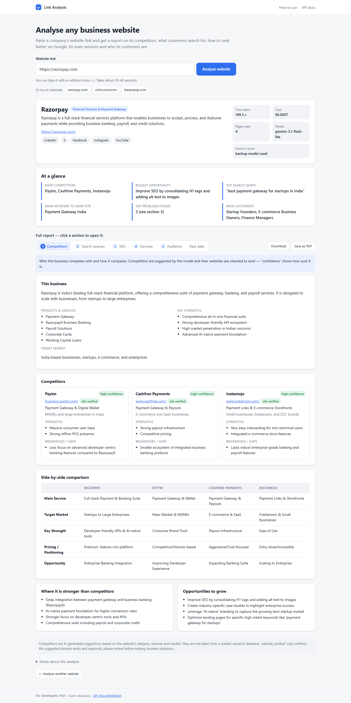
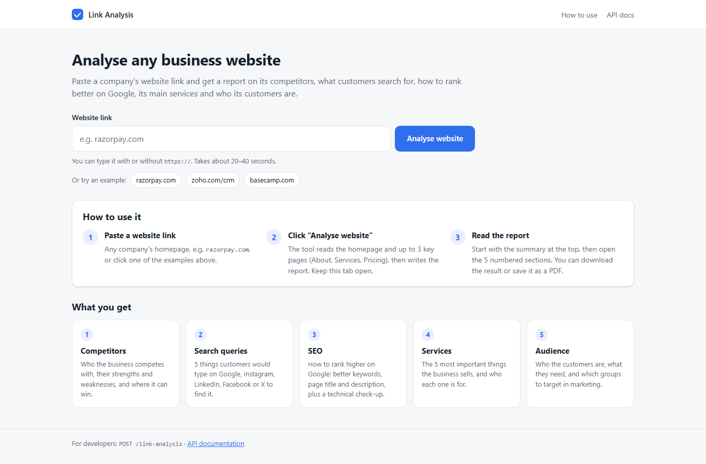
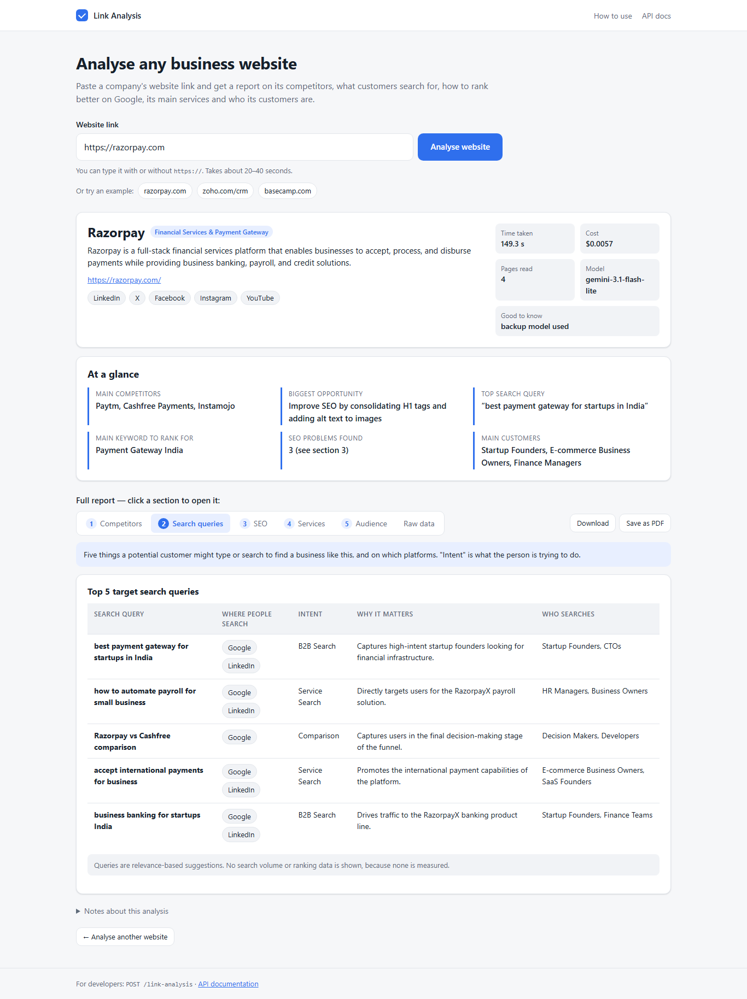
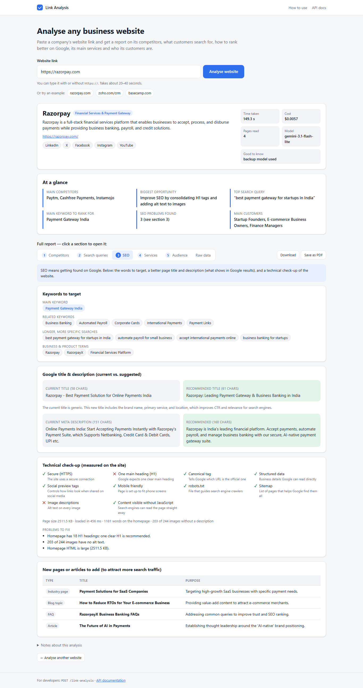
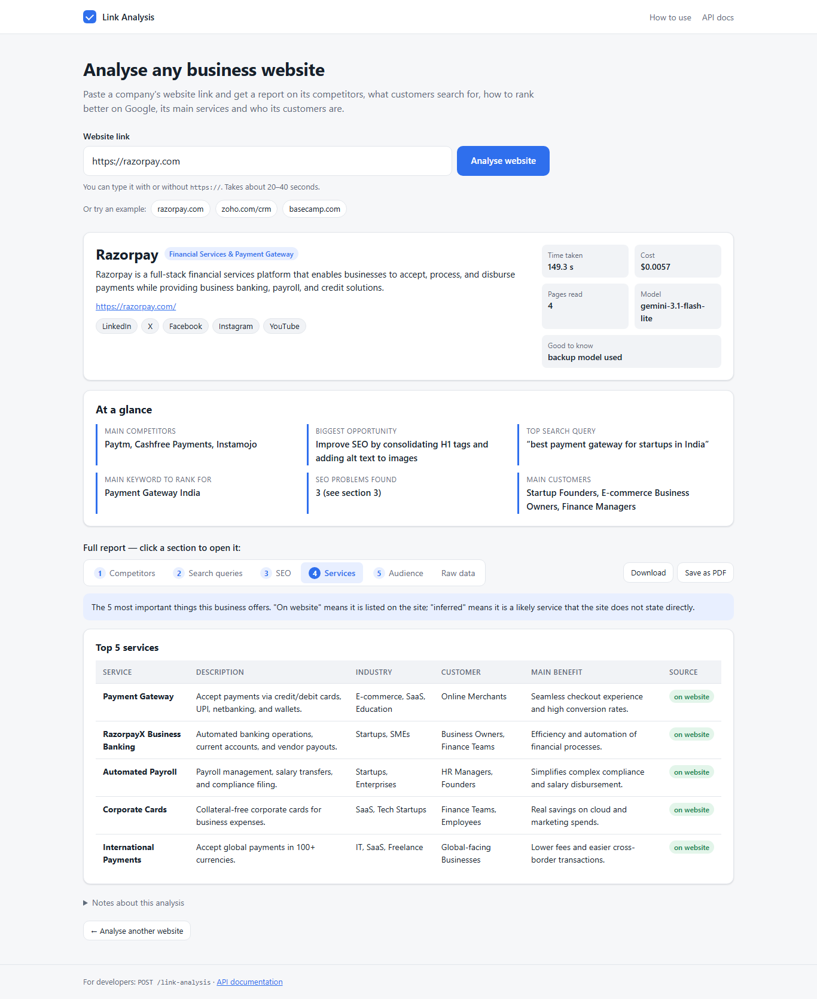
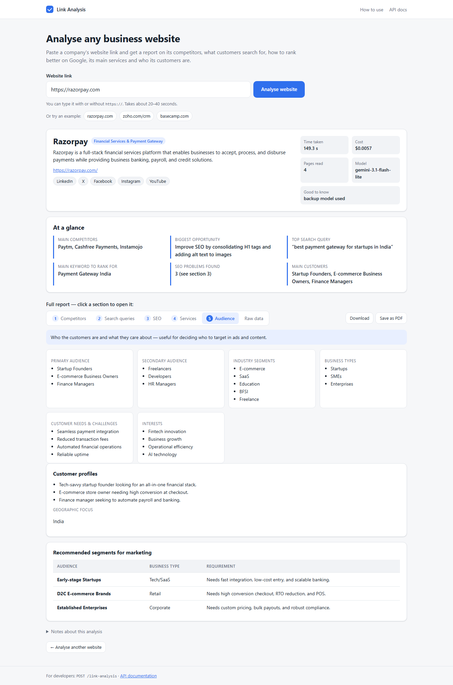
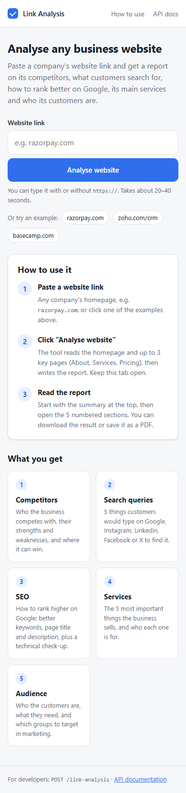
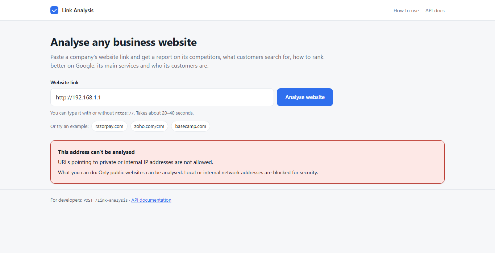

# Link Analysis

Give it a website link and it tells you what that business does, who it competes with, what its customers search for, how it could rank better on Google, its main services and who its customers are.

It's a FastAPI service with a small web front end. It reads the actual website (homepage plus a few key pages), sends the cleaned-up content to an LLM (Google Gemini by default), checks the answer, and returns one structured JSON report.

> **Before you run it: you need your own Gemini API key.**
> API keys are never committed to this repository, so a fresh clone has none. Getting one is free and takes a minute at https://aistudio.google.com/apikey; put it in a `.env` file as shown in [step 3 of the quick start](#quick-start). Without a key the server still starts and the web page and `/docs` open, but every analysis returns `503 llm_not_configured`.



---

## Contents

- [What you get](#what-you-get)
- [Quick start](#quick-start)
- [How to use it](#how-to-use-it)
  - [In the browser](#1-in-the-browser)
  - [From the API docs page](#2-from-the-api-docs-page)
  - [From code / the command line](#3-from-code-or-the-command-line)
- [Configuration](#configuration)
- [How it works](#how-it-works)
- [Error handling](#error-handling)
- [Security (SSRF protection)](#security-ssrf-protection)
- [Tests](#tests)
- [Deployment](#deployment)
- [LLM research: cost, speed and accuracy](#llm-research-cost-speed-and-accuracy)
- [Project structure](#project-structure)
- [Troubleshooting](#troubleshooting)
- [Limitations and next steps](#limitations-and-next-steps)

---

## What you get

One request, one report with five sections:

| # | Section | What it answers |
|---|---|---|
| 1 | **Competitors** | Who does this business compete with? Strengths, weaknesses, a side-by-side comparison and where it can win. |
| 2 | **Top 5 search queries** | What would a customer type to find it, and on which platform (Google, Facebook, Instagram, LinkedIn, X)? |
| 3 | **SEO improvements** | Which keywords to target, a better page title and meta description, new pages to write, and a measured technical check-up. |
| 4 | **Top 5 services** | What does it actually sell? Each service is marked as found on the website or inferred. |
| 5 | **Target audience** | Who are the customers, what do they need, and which groups are worth targeting? |

On top of that:

- **Works on JavaScript sites.** React / Vue / Next.js sites send an almost empty page; those are opened in a headless browser so the analysis is based on the real content.
- **Facts are kept separate from guesses.** The SEO check-up, social profiles and contact details are measured from the site. Competitors are labelled as model suggestions (with a confidence level) and their websites are checked to exist. Search volumes are never made up.
- **Cheap and resilient.** One model call per analysis (about $0.01–0.02), results cached for an hour, and a backup model takes over automatically if the main one is busy.
- **Safe to expose.** Private and internal addresses are blocked (SSRF protection), and there is a per-IP rate limit.

---

## Quick start

You need **Python 3.11+** and a **Gemini API key** (free at https://aistudio.google.com/apikey).

**1. Get the code**

```bash
git clone https://github.com/hari-om65/link-analysis.git
cd link-analysis
```

**2. Create a virtual environment and install**

Windows (PowerShell):

```powershell
python -m venv .venv
.venv\Scripts\python -m pip install -r requirements.txt
.venv\Scripts\python -m playwright install chromium
```

macOS / Linux:

```bash
python3 -m venv .venv
source .venv/bin/activate
pip install -r requirements.txt
python -m playwright install chromium
```

The last line downloads a headless Chromium (~120 MB). It's only used for JavaScript-heavy websites, so you can skip it; everything else still works.

**3. Add your API key (required)**

The repository doesn't contain a key, so this step is needed on every new machine.

1. Create a free key at https://aistudio.google.com/apikey (sign in with Google → **Create API key** → copy it).
2. Make your own `.env` file from the template:

   ```bash
   cp .env.example .env        # Windows: copy .env.example .env
   ```

3. Open `.env` in any editor and paste the key after `GEMINI_API_KEY=`, with no quotes or spaces:

   ```env
   GEMINI_API_KEY=AIza...your-key...
   ```

4. Save the file. If the server is already running, restart it so it picks up the key.

`.env` is listed in `.gitignore`, so your key stays on your machine and is never pushed. The other values in `.env.example` are sensible defaults; see [Configuration](#configuration) if you want to change them.

Check it worked: when the server starts there should be **no** line saying `No API key found`. If there is, the key wasn't picked up.

**4. Start the server**

```bash
uvicorn app.main:app --host 0.0.0.0 --port 4000
```

On Windows without activating the environment: `.venv\Scripts\python -m uvicorn app.main:app --host 0.0.0.0 --port 4000`

You should see:

```
INFO | app | LLM: gemini/gemini-3-flash-preview -> gemini/gemini-3.1-flash-lite
INFO | app | JavaScript rendering: enabled
INFO:     Uvicorn running on http://0.0.0.0:4000
```

Keep that terminal open; closing it stops the server.

**5. Open it**

| Address | What it is |
|---|---|
| http://localhost:4000/ | The web app (start here) |
| http://localhost:4000/docs | Interactive API documentation (Swagger) |
| http://localhost:4000/health | Quick "is it running?" check |

---

## How to use it

### 1. In the browser

Open **http://localhost:4000/**.



1. Type a website into **Website link**, e.g. `razorpay.com` (the `https://` is optional), or click one of the examples.
2. Click **Analyse website**. A checklist shows the progress; it usually takes 20–40 seconds.
3. The report opens with:
   - a **company card**: what it does, its website, social media pages and contact details, plus how long the analysis took and what it cost;
   - an **At a glance** box: main competitors, biggest opportunity, top search query, main keyword, number of SEO problems, main customers;
   - **five numbered tabs**, one per section, each starting with a one-line explanation.
4. Use **Download** for the JSON file, **Save as PDF** for a printable report, or **Analyse another website** to start again.

You can also share a link that runs straight away: `http://localhost:4000/?url=razorpay.com`

| Search queries | SEO and technical check-up |
|---|---|
|  |  |

| Services | Audience | Phone |
|---|---|---|
|  |  |  |

If something goes wrong, the page says what happened and what to try next:



### 2. From the API docs page

Open **http://localhost:4000/docs**, expand **POST /link-analysis**, pick one of the ready-made examples (or type your own URL) and click **Execute**. The result shows up under **Server response → Response body**. The page also shows a real example result and an example for every error.

### 3. From code or the command line

There is one endpoint:

```http
POST /link-analysis
Content-Type: application/json

{ "url": "https://razorpay.com" }
```

**curl**

```bash
curl -X POST http://localhost:4000/link-analysis \
  -H "Content-Type: application/json" \
  -d '{"url": "https://razorpay.com"}'
```

**PowerShell**

```powershell
Invoke-RestMethod -Method Post -Uri http://localhost:4000/link-analysis `
  -ContentType "application/json" -Body '{"url": "https://razorpay.com"}' | ConvertTo-Json -Depth 10
```

**Python**

```python
import httpx

r = httpx.post("http://localhost:4000/link-analysis", json={"url": "https://razorpay.com"}, timeout=120)
report = r.json()
print(report["brand"]["name"], [c["name"] for c in report["analysis"]["competitor_analysis"]["competitors"]])
```

**What comes back:** `brand` (who the business is), `analysis` (the five sections) and `meta` (model, time, cost, pages read).

<details>
<summary><b>Show an example response</b> (real result for razorpay.com, cut down to one item per list)</summary>

```json
{
  "success": true,
  "website": "https://razorpay.com/",
  "brand": {
    "name": "Razorpay",
    "category": "Fintech and Financial Services",
    "summary": "Razorpay is India's leading full-stack financial services platform providing a comprehensive suite for businesses to accept payments, automate banking, and manage payroll.",
    "social_profiles": {
      "LinkedIn": "https://www.linkedin.com/company/razorpay",
      "X": "https://twitter.com/razorpay"
    },
    "contact_emails": [],
    "contact_phones": []
  },
  "analysis": {
    "competitor_analysis": {
      "your_brand": {
        "name": "Razorpay",
        "overview": "A full-stack finance platform offering payment gateways, business banking via RazorpayX, and automated payroll solutions. It is built with a developer-first approach and serves over 150,000 businesses.",
        "category": "Financial Services Platform",
        "main_products_services": [
          "Payment Gateway",
          "RazorpayX Business Banking"
        ],
        "target_market": "Startups, E-commerce, Enterprises, and Freelancers in India and Southeast Asia.",
        "key_strengths": [
          "Developer-friendly APIs"
        ]
      },
      "competitors": [
        {
          "name": "Cashfree Payments",
          "website": "https://www.cashfree.com",
          "main_service": "Payment Gateway and Payouts",
          "target_market": "E-commerce and SaaS businesses in India",
          "strengths": [
            "Bulk disbursals"
          ],
          "weaknesses": [
            "Less integrated payroll ecosystem compared to RazorpayX"
          ],
          "confidence": "high",
          "source": "ai_suggestion",
          "website_verified": true
        }
      ],
      "comparison": [
        {
          "aspect": "Main Service",
          "your_brand": "Full-stack Finance Platform",
          "competitors": {
            "Cashfree Payments": "Payment Gateway & Payouts"
          }
        }
      ],
      "competitive_advantages": [
        "Unified dashboard for payments, banking, and payroll."
      ],
      "opportunities": [
        "Consolidate H1 tags to improve SEO ranking for 'Payment Gateway India'."
      ]
    },
    "target_search_queries": [
      {
        "query": "best payment gateway for startups india",
        "platforms": [
          "Google",
          "LinkedIn"
        ],
        "intent": "Service Search",
        "business_relevance": "Directly targets the core customer segment looking for a reliable payment solution.",
        "target_audience": "Startup Founders and CTOs"
      }
    ],
    "seo_improvements": {
      "primary_keyword": "Payment Gateway India",
      "secondary_keywords": [
        "Online Payments India",
        "Business Banking"
      ],
      "long_tail_keywords": [
        "best payment gateway for ecommerce india",
        "accept international payments without website"
      ],
      "business_keywords": [
        "Full-stack financial services",
        "AI Native Payments"
      ],
      "recommended_title": "Razorpay: #1 Payment Gateway & Business Banking in India",
      "title_rationale": "The current title is good but adding '#1' and 'Business Banking' highlights the full-stack nature of the platform beyond just payments, fitting the 50-60 character limit.",
      "meta_description": "Accept online payments instantly with Razorpay, India's best payment gateway. Manage business banking, automate payroll, and get credit. Trusted by 150k+ businesses.",
      "supporting_content": [
        {
          "type": "Industry page",
          "title": "Payment Solutions for Educational Institutions",
          "purpose": "To target schools and colleges looking for fee collection and vendor payouts."
        }
      ],
      "current_seo_audit": {
        "current_title": "Razorpay - Best Payment Solution for Online Payments India",
        "title_length": 58,
        "h1_count": 18,
        "images_missing_alt": 203,
        "has_robots_txt": true,
        "sitemap_url": "https://razorpay.com/sitemap.xml",
        "rendered_with_javascript": false,
        "response_time_ms": 409,
        "issues": [
          "Homepage has 18 H1 headings; one clear H1 is recommended.",
          "203 of 244 images have no alt text."
        ],
        "...": "more measured fields"
      }
    },
    "top_services": [
      {
        "service_name": "Payment Gateway",
        "description": "Advanced gateway supporting 100+ payment modes including UPI, Cards, and Netbanking.",
        "target_industry": "E-commerce, SaaS, Education",
        "target_customer": "Online Merchants",
        "main_benefit": "Industry-leading success rates and 5X quicker checkout.",
        "source": "website"
      }
    ],
    "target_audience": {
      "primary_audience": [
        "Startup Founders"
      ],
      "secondary_audience": [
        "Freelancers"
      ],
      "industry_segments": [
        "E-Commerce"
      ],
      "business_types": [
        "D2C Brands"
      ],
      "customer_profiles": [
        "The Tech-Savvy Founder: Needs quick integration and scalable APIs."
      ],
      "geographic_focus": "India, Singapore, United States, Malaysia",
      "customer_needs": [
        "Frictionless transaction processing"
      ],
      "customer_interests": [
        "Fintech innovation"
      ],
      "recommended_segments": [
        {
          "audience": "D2C Brand Owners",
          "business_type": "E-commerce",
          "requirement": "Reduction in RTO (Return to Origin) and Magic Checkout."
        }
      ]
    }
  },
  "meta": {
    "llm_provider": "gemini",
    "llm_model": "gemini-3-flash-preview",
    "used_fallback": false,
    "pages_analyzed": [
      "https://razorpay.com/",
      "https://razorpay.com/about/"
    ],
    "input_tokens": 7982,
    "output_tokens": 6100,
    "estimated_cost_usd": 0.022291,
    "llm_latency_ms": 36542,
    "total_duration_ms": 39249,
    "cached": false,
    "generated_at": "2026-11-18T17:42:27.617725Z",
    "notes": []
  }
}
```

</details>

Full, unshortened responses are in [docs/samples/](docs/samples/):

| File | What it shows |
|---|---|
| [success-razorpay-com.json](docs/samples/success-razorpay-com.json) | Full report for razorpay.com |
| [success-www-zoho-com-crm.json](docs/samples/success-www-zoho-com-crm.json) | Full report for zoho.com/crm |
| [error-private-ip.json](docs/samples/error-private-ip.json), [error-cloud-metadata.json](docs/samples/error-cloud-metadata.json), [error-localhost.json](docs/samples/error-localhost.json) | Internal addresses being blocked |
| [error-bot-protection-403.json](docs/samples/error-bot-protection-403.json) | A website that blocks automated visitors |
| [error-invalid-url.json](docs/samples/error-invalid-url.json), [error-unknown-domain.json](docs/samples/error-unknown-domain.json) | Bad input |

To capture fresh samples from your own server (local or deployed):

```bash
python -m scripts.capture_samples
python -m scripts.capture_samples --base-url https://your-app.onrender.com --urls https://razorpay.com
```

Server logs from real runs are in [docs/logs/](docs/logs/).

---

## Configuration

Everything is set through environment variables (or the `.env` file). The defaults are fine for most uses.

| Variable | Default | What it does |
|---|---|---|
| `GEMINI_API_KEY` | – | **Required** for the default provider |
| `LLM_PROVIDER` / `LLM_MODEL` | `gemini` / `gemini-3-flash-preview` | Main model. Providers: `gemini`, `openai`, `groq` |
| `LLM_FALLBACK_PROVIDER` / `LLM_FALLBACK_MODEL` | `gemini` / `gemini-3.1-flash-lite` | Backup model if the main one fails or is overloaded |
| `OPENAI_API_KEY`, `GROQ_API_KEY` | – | Only needed if you use those providers |
| `GEMINI_THINKING_LEVEL` | `low` | How much the model "thinks"; higher is slower and more expensive |
| `LLM_TIMEOUT_SECONDS` / `LLM_MAX_RETRIES` | `60` / `1` | Per-request timeout and retries before falling back |
| `ENABLE_JS_RENDERING` | `true` | Use the headless browser for JavaScript sites |
| `JS_RENDER_MAX_CONCURRENT` | `2` | Browser pages at once (use `1` on small servers) |
| `MAX_EXTRA_PAGES` | `3` | Extra pages to read besides the homepage |
| `MAX_CONTENT_CHARS` | `14000` | How much website text is sent to the model |
| `CACHE_TTL_SECONDS` | `3600` | How long a result is reused (0 = no cache) |
| `RATE_LIMIT_PER_MINUTE` | `10` | Analyses per minute per IP (0 = off) |
| `VERIFY_COMPETITOR_SITES` | `true` | Check that suggested competitor websites exist |

The full list with comments is in [.env.example](.env.example).

---

## How it works

```
 POST /link-analysis {url}
        │
        ▼
 1. Validate URL ───────────── syntax, scheme, port, block private / internal hosts
        │                      rate limit per client IP
        ▼
 2. Cache / in-flight check ── same URL within 1h → instant, $0
        │                      same URL already being analysed → wait for that result
        ▼
 3. Fetch homepage ─────────── redirects followed manually, every hop re-checked (SSRF)
        │                      2.5 MB cap, HTML only, 12 s timeout
        ▼
 4. JavaScript app? ────────── empty #root / #app / #__next shell and almost no text
        │                      → render in headless Chromium (every browser request SSRF-checked)
        ▼
 5. Extract & clean ────────── title, meta, OG, JSON-LD, H1–H3, nav, footer, social profiles, contacts
        │                      strips scripts/styles/cookie banners, dedupes lines
        ├─ picks up to 3 key internal pages (about / services / products / pricing)
        ├─ checks robots.txt and the XML sitemap
        ├─ technical SEO audit (measured, no LLM)
        ▼
 6. Build prompt ───────────── content trimmed to ~14k chars (≈3.5k tokens)
        │
        ▼
 7. LLM call (JSON mode) ───── one call generates all five sections
        │                      retry on 429/5xx, fallback model if the primary fails
        ▼
 8. Validate with Pydantic ─── if invalid → one "repair" call with the exact errors
        │
        ▼
 9. Post-process ───────────── drop the brand from its own competitor list,
        │                      check each competitor domain actually exists,
        │                      attach audit, social profiles, notes, token usage and cost
        ▼
10. JSON response
```

A few decisions worth calling out:

- **One LLM call, not five.** All sections share the same website context, so generating them together costs roughly a fifth of the input tokens compared to one call per section, and the sections stay consistent with each other.
- **The browser is a fallback, not the default.** Plain HTTP takes about 0.3 s; Chromium takes 3–10 s and a lot more memory. It only starts when the static HTML looks like an empty JavaScript app shell, and it starts lazily on first use.
- **Plain HTTP instead of SDKs.** Gemini, OpenAI and Groq are called through their REST APIs with `httpx`, so there is one place for timeouts and retries, and switching provider is just an env var.
- **Facts vs. AI suggestions are kept apart.** The SEO audit, social profiles and contacts are measured from the site. Competitors are always marked `"source": "ai_suggestion"` with a `confidence` level, and services that aren't on the site are marked `"inferred"`. Search volumes are never produced.
- **Content checks, not status codes.** Many JavaScript apps answer *every* path, including `/robots.txt` and `/sitemap.xml`, with `200 OK` and their HTML shell. The audit checks the response is a real robots file or sitemap before counting it.

---

## Error handling

Every error uses the same shape:

```json
{ "success": false, "error": { "code": "blocked_url", "message": "URLs pointing to private or internal IP addresses are not allowed." } }
```

| HTTP | `code` | When |
|---:|---|---|
| 422 | `validation_error` | Request body missing / malformed |
| 422 | `invalid_url` | Not a URL, unsupported scheme, credentials in URL, no domain |
| 400 | `blocked_url` | Private / loopback / link-local / cloud-metadata address, internal hostnames, non-web ports |
| 429 | `rate_limited` | Too many analyses from one IP; the `Retry-After` header says when to retry |
| 502 | `dns_resolution_failed` | Domain doesn't exist |
| 502 | `website_access_denied` | Site answers 401/403/429 (bot protection) |
| 502 | `website_not_found` | Site answers 404 |
| 502 | `website_unreachable` | Connection error or other 4xx/5xx |
| 504 | `website_timeout` | Site too slow |
| 422 | `content_not_usable` | Not an HTML page, or a page with no readable content even after rendering |
| 503 | `llm_not_configured` | No API key for the configured provider |
| 502 | `llm_error` / `llm_auth_failed` / `llm_truncated` / `llm_invalid_output` | Provider failure, bad key, cut-off output, or JSON that is still invalid after the repair attempt |
| 504 | `llm_timeout` | Provider timed out |

Logs from real runs are in [docs/logs/](docs/logs/), and the matching responses (including a site that blocks bots) are in [docs/samples/](docs/samples/).

---

## Security (SSRF protection)

Because the API fetches arbitrary URLs on the server, it must not become a proxy into internal networks. [app/utils/validators.py](app/utils/validators.py) handles this:

- only `http` / `https`, no `user:pass@` URLs, only ports 80, 443, 8080, 8443
- IP literals must be public (`ipaddress.is_global`); this rejects `127.0.0.0/8`, `10/8`, `172.16/12`, `192.168/16`, `169.254/16` (cloud metadata), `100.64/10`, `0.0.0.0`, `::1`, IPv4-mapped IPv6, etc.
- hostnames like `localhost`, `*.local`, `*.internal`, `metadata.google.internal` are rejected
- the hostname is **resolved via DNS and every returned address is checked**, so `evil.com → 127.0.0.1` is blocked too
- redirects are followed **manually**, re-validating every hop (a public URL redirecting to `http://10.0.0.1/` is blocked)
- **headless browser:** every request the page makes (scripts, XHR/fetch, iframes, redirects) is intercepted and checked the same way before it leaves the browser; images, fonts and media are not loaded at all
- extra pages are only fetched on the same site; competitor checks never follow redirects
- response size is capped and only HTML is parsed
- everything the UI shows is inserted with `textContent`, never `innerHTML`, because it contains text from third-party sites; links are limited to `http(s)`

API keys are only read from environment variables, `.env` is git-ignored, and keys are never logged.

Known gap: there is a small time window between the DNS check and the actual connection (DNS rebinding). Closing it fully would mean pinning the resolved IP in a custom transport.

---

## Tests

```bash
pip install -r requirements-dev.txt
pytest -v
```

81 tests, no network, browser or API key needed (HTTP is mocked with `httpx.MockTransport`, the LLM and the browser with fakes):

- `tests/test_link_analysis.py` – end-to-end through the FastAPI endpoint: all five sections, content actually reaching the prompt, sub-page crawling, competitor de-dup and verification, platform normalisation, inferred-service labelling, cost calculation, caching, JSON repair, provider fallback, and every error path (invalid URL, private IPs, redirect to internal IP, 403, timeout, non-HTML, empty page, 404)
- `tests/test_extraction_features.py` – JavaScript app detection and rendering (including sub-pages), browser request guard, social profiles (company page over posts and people, share buttons ignored), contacts, robots.txt / sitemap / viewport, rate limiting, request IDs, concurrent identical requests sharing one LLM call, web UI
- `tests/test_llm_service.py` – exact request payloads for Gemini / OpenAI / Groq, response parsing, thinking-token accounting, retry on 429, no retry on bad key, truncated output
- `tests/test_validators.py` – URL normalisation and SSRF cases

Latest run: [docs/logs/test-run.log](docs/logs/test-run.log).

---

## Deployment

### Render (free tier)

The repo includes a [render.yaml](render.yaml) blueprint that builds the [Dockerfile](Dockerfile) (the Docker image is needed because Chromium requires system libraries).

1. Push the repo to GitHub.
2. On https://render.com → **New → Blueprint** → select the repo.
3. Fill in `GEMINI_API_KEY` when asked.
4. After the deploy:
   - Web UI: `https://<your-service>.onrender.com/`
   - API: `https://<your-service>.onrender.com/link-analysis`
   - Docs: `https://<your-service>.onrender.com/docs`

The free plan sleeps after inactivity, so the first request can take ~30–50 s to wake up. It has 512 MB of RAM, so the blueprint limits the browser to one page at a time.

### Docker (any VPS, Railway, Fly.io, Cloud Run...)

```bash
docker build -t link-analysis .
docker run -p 4000:4000 --env-file .env link-analysis
```

The container listens on `$PORT` if the platform sets it, otherwise 4000, and runs as a non-root user.

Tested with `--memory=512m` (same as the Render free plan): a JavaScript-rendered site was analysed with the browser running, and the container stayed around 170 MB. The log is in [docs/logs/docker-run.log](docs/logs/docker-run.log). The image is about 1.4 GB because of Chromium; without JavaScript rendering it would be around 200 MB.

---

## LLM research: cost, speed and accuracy

> **What is measured and what is estimated.** Prices come from the official provider pricing pages (checked 18 Nov 2026, links below). Rows marked **measured** come from real runs on 18 Nov 2026: three live API calls (`docs/samples/`, logs in `docs/logs/`) and [scripts/benchmark_llm.py](scripts/benchmark_llm.py) (`docs/benchmark/results.md`). Everything else is an **estimate** and labelled that way. Accuracy was judged by spot-checking brand, keyword and competitors on two sites; that is not a formal accuracy benchmark, so I don't claim any model is "the most accurate".

### Workload profile (measured)

| Site | Model | Input tokens | Output tokens (incl. thinking) | LLM time | Cost |
|---|---|---:|---:|---:|---:|
| basecamp.com (4 pages) | gemini-3-flash-preview | 4,486 | 3,183 | 14.3 s | $0.0118 |
| razorpay.com (4 pages) | gemini-3-flash-preview | 4,396 | 3,077 | 13.5 s | $0.0114 |
| zoho.com/crm (4 pages) | gemini-3-flash-preview | 7,809 | 6,385 | 26.2 s | $0.0230 |
| basecamp.com (benchmark) | gemini-3.1-flash-lite | 3,944 | 3,076 | 9.2 s | $0.0056 |

The extracted website content is capped at 14,000 characters, so input stays around 4–8k tokens. Output varies more (3–6.5k tokens) because larger sites produce longer lists. For the estimated rows in the comparison I use **5,000 input + 4,000 output tokens** per analysis.

### A. Platform comparison

| Provider | Model | Price per 1M tokens (in / out) | Cost per analysis | Speed | Context window | JSON support | Notes |
|---|---|---|---:|---|---|---|---|
| Google | **gemini-3-flash-preview** | $0.50 / $3.00 | **$0.011–0.023 measured** (avg $0.016) | **14–26 s measured**, 5/5 runs valid | 1M (Flash family) | Native JSON mode + response schema | **Used as primary.** The only model that answered reliably during testing; good competitor picks (Asana/Monday/Trello, Salesforce/HubSpot/Pipedrive) |
| Google | **gemini-3.1-flash-lite** (stable) | $0.25 / $1.50 | **$0.0056 measured** | **9.2 s measured**; 1 of 2 runs hit a 503 overload | 1M (Flash family) | Native JSON mode + schema | **Used as fallback.** About 3× cheaper and 2× faster, accurate on basecamp.com |
| Google | gemini-3.5-flash-lite (stable) | $0.30 / $2.50 | ≈ $0.0115 est. | not measurable: **503 "high demand" on all 5 attempts** | 1M (Flash family) | Native JSON mode + schema | Google's official successor to 2.5 Flash. Good on paper, but its capacity was not available to this key during testing |
| Google | gemini-3.6-flash | $0.75 / $3.75 (promo until 31 Dec 2026, then $1.50 / $7.50) | ≈ $0.019 est. | **slow: 80 s and a 60 s timeout measured** | not stated | JSON mode | Returned a JSON array instead of an object once (the parser now handles that). Not recommended for an interactive API |
| Google | gemini-2.5-flash-lite | $0.10 / $0.40 | ≈ $0.0021 est. | – | 1M | JSON mode | **API returns 404 "no longer available to new users"** (verified) |
| OpenAI | gpt-5-mini | $0.25 / $2.00 | ≈ $0.0093 est. | est. 15–30 s (reasoning) | 400K | `json_object` + strict `json_schema` | Supported by the app; best choice for cross-provider redundancy (needs an OpenAI key, not measured) |
| OpenAI | gpt-5-nano | $0.05 / $0.40 | ≈ $0.0019 est. | est. fast | 400K | `json_object` + `json_schema` | Very cheap; likely thinner on competitor knowledge |
| OpenAI | gpt-5.4-mini | $0.75 / $4.50 | ≈ $0.022 est. | est. medium | 400K | `json_object` + `json_schema` | Higher-quality tier at a higher price |
| OpenAI | gpt-4.1-mini | $0.40 / $1.60 | ≈ $0.0084 est. | est. fast (no reasoning) | ~1M | `json_object` + `json_schema` | Predictable latency, older model |
| Groq | openai/gpt-oss-120b | $0.15 / $0.60 | ≈ $0.0032 est. | ~500 tok/s per Groq docs (est. 5–10 s) | 131K | `json_object` | Fastest and cheap; open-weight model with less current market knowledge |

Notes from the research:

- **`gemini-2.5-flash` is deprecated and shuts down on 1 Dec 2026**, and `gemini-2.5-flash-lite` is already closed to new users. Most tutorials still use these, so I checked availability before choosing.
- During testing, Google's newest models were often overloaded (HTTP 503). That is why the app retries with backoff and then **automatically falls back to a second model**. In the zoho sample, `meta.used_fallback: true` shows this happening for real; the razorpay sample shows the normal path.
- Gemini bills thinking tokens as output tokens. The app adds `thoughtsTokenCount` into `meta.output_tokens`, so the reported cost is the real cost.
- Context window is not a constraint: prompts are 4–8k tokens, far below every model's limit.

### B. Best model selection

| Criterion | gemini-3-flash-preview (primary) | gemini-3.1-flash-lite (fallback) |
|---|---|---|
| Understanding website content | Correct brand, category and services on all three test sites; services taken from real page content (e.g. Zoho's "Zia AI Agents", "Canvas Design Studio") | Correct brand, keyword and competitors on basecamp.com |
| Response speed | 14–26 s measured | 9 s measured |
| API cost | $0.011–0.023 measured | $0.0056 measured |
| Reliable structured JSON | 5/5 valid on the first try (no repair call needed) | 1/1 valid when available |
| Competitor and SEO insight | Relevant, verified competitor domains (e.g. Cashfree, PayU, Stripe for Razorpay); SEO titles 55–58 chars and meta descriptions 158–159 chars, as requested | Same competitor set on basecamp.com |
| Large websites | 1M context; the app sends only ~14k chars anyway | same |
| Availability | Answered every request during testing | Overloaded on 1 of 2 runs |

### C. Cost optimisation (implemented)

| Technique | Where | Effect |
|---|---|---|
| Strip scripts, styles, SVG, nav/footer, cookie banners; dedupe repeated lines | `website_extractor.py` | basecamp.com: 4 pages / 20k chars of readable text reduced to a 14k-char prompt (raw HTML is far larger) |
| Only crawl up to 3 high-value internal pages (about/services/products/pricing), skip login/legal/blog | `_pick_extra_pages` | Better context without crawling the whole site |
| Fixed character budget per page (homepage 50%, rest shared) | `WebsiteContent.to_prompt` | Predictable, capped input tokens |
| One LLM call for all five sections | `analysis_service.py` | ~5× fewer input tokens than a call per section |
| Compact JSON template instead of a verbose JSON Schema in the prompt | `prompts.py` | Smaller prompt |
| Deterministic work done in Python, not by the LLM (SEO audit, competitor domain checks, de-duplication, platform normalisation) | extractor + `competitor_service.py` | Fewer output tokens and fewer hallucinations |
| Cache by normalised URL (1 h TTL, configurable) | `utils/cache.py` | Repeat request measured at **0.2 s and $0** vs 48 s / $0.012 |
| Repair call only when validation fails, sending just the error list | `_generate_validated` | Avoids blind full retries |
| Retry only on 408/429/5xx with backoff, never on auth errors; then fail over | `llm_service.py` | No wasted calls, and overloads don't break the API |
| Low thinking / reasoning effort by default | `.env` | Fewer billed reasoning tokens |
| Exact usage and cost returned in `meta` and logged | `analysis_service.py` | Spend is visible per request |

Further savings for production: switch the primary to `gemini-3.1-flash-lite` or `gemini-3.5-flash-lite` once their capacity is stable (about 50–65% cheaper, with no code change, only an env var); Batch API (about 50% cheaper) for bulk jobs; context caching of the fixed system prompt; Redis instead of the in-memory cache when running several instances.

### D. Final recommendation

| Item | Recommendation |
|---|---|
| Provider | Google Gemini API |
| Model | `gemini-3-flash-preview` with `GEMINI_THINKING_LEVEL=low` |
| Input tokens | **4,500–7,800 per analysis (measured)** |
| Output tokens | **3,200–6,400 per analysis incl. thinking (measured)** |
| Cost | **$0.011–0.023 per website, avg ≈ $0.016 (measured)** ≈ $16 per 1,000 analyses; $0 when cached |
| Response time | **LLM 14–26 s, end to end 15–30 s when the primary answers directly (measured)**. During today's overloads, failing over added about 20–35 s |
| Why | It was the only model that was both available and produced valid, site-specific output every time, at about 1.6 cents per analysis |
| Fallback | `gemini-3.1-flash-lite`: same key, 9 s, $0.0056 (measured). With an OpenAI key, `gpt-5-mini` adds provider-level redundancy |
| Watch-list | `gemini-3.5-flash-lite` (stable, cheaper). Re-run the benchmark when its capacity frees up and switch with `LLM_MODEL=` if it holds quality |
| Balancing approach | Use one reliable mid-price model as primary and a cheap, fast model as fallback; keep deterministic parts out of the LLM; validate and repair instead of retrying blindly; cache results; re-benchmark periodically, because model availability and pricing change quickly (two Gemini models used in most tutorials are already retired) |

### Running the benchmark

```bash
python -m scripts.benchmark_llm                    # default URLs, every model with a key in .env
python -m scripts.benchmark_llm --runs 3 --urls https://basecamp.com https://www.freshworks.com
```

It extracts each site once, sends the identical prompt to every model, and writes `docs/benchmark/results.md` with the median latency, tokens, cost and whether the output passed validation, plus a spot-check of brand, keyword and competitors per model for manual accuracy review.

### Sources

- Gemini pricing: https://ai.google.dev/gemini-api/docs/pricing
- Gemini models and deprecations: https://ai.google.dev/gemini-api/docs/models, https://ai.google.dev/gemini-api/docs/deprecations
- OpenAI pricing: https://platform.openai.com/docs/pricing
- Groq models, pricing and speeds: https://console.groq.com/docs/models

---

## Project structure

```
ai-link-analysis/
├── app/
│   ├── main.py                    # FastAPI app, routes, middleware, error handlers, wiring
│   ├── config.py                  # settings from env + model price table
│   ├── schemas.py                 # request / response / LLM output models
│   ├── exceptions.py              # typed errors → HTTP status + error code
│   ├── services/
│   │   ├── website_extractor.py   # safe fetching, parsing, sub-pages, social, robots/sitemap, SEO audit
│   │   ├── js_renderer.py         # headless Chromium fallback with SSRF-checked requests
│   │   ├── llm_service.py         # Gemini / OpenAI / Groq clients, retries, JSON parsing
│   │   ├── analysis_service.py    # orchestration, validation + repair, fallback, cache, request merging
│   │   ├── competitor_service.py  # competitor clean-up and domain verification
│   │   └── prompts.py             # system prompt, JSON template, repair prompt
│   ├── utils/
│   │   ├── validators.py          # URL validation + SSRF protection
│   │   ├── cache.py               # in-memory TTL cache
│   │   └── rate_limit.py          # per-IP sliding-window limiter
│   └── static/                    # web UI (plain HTML / CSS / JS, no build step)
├── tests/                         # 81 tests (mocked HTTP, fake LLM, fake browser)
├── scripts/
│   ├── benchmark_llm.py           # compare models on identical prompts
│   └── capture_samples.py         # save real API responses to docs/samples
├── docs/
│   ├── samples/                   # captured request/response JSON
│   ├── screenshots/               # web UI
│   ├── benchmark/                 # measured model comparison
│   └── logs/                      # server and test logs
├── Dockerfile
├── render.yaml
├── .env.example
├── requirements.txt
└── requirements-dev.txt
```

---

## Troubleshooting

| Problem | Fix |
|---|---|
| Browser says **"localhost refused to connect"** | The server isn't running. Start it (step 4 of the quick start) and keep that terminal open. |
| **`WinError 32 ... being used by another process`** during `pip install` | OneDrive or antivirus is locking files in the project folder. Pause OneDrive syncing, delete `.venv` and run the install again, or keep the project outside OneDrive. |
| PowerShell says **"running scripts is disabled"** when activating the venv | Skip activation and call the venv's Python directly: `.venv\Scripts\python -m ...` |
| **`llm_not_configured`** (503) | `GEMINI_API_KEY` isn't set. Check `.env` is in the project folder and restart the server. |
| **`llm_error` … "high demand"** | Google's model is temporarily overloaded. The backup model usually covers this; if both are busy, wait a minute and try again. |
| **`website_access_denied`** (502) | The site blocks automated visitors (Cloudflare and similar). Nothing to fix on our side; try another site. |
| JavaScript site analysed from its title only | Chromium isn't installed. Run `python -m playwright install chromium` and restart. On Windows, don't start uvicorn with `--reload`. |
| **Port 4000 is already in use** | Another server is still running. Close it, or start on another port: `--port 4001`. |
| `/docs` shows `string`, `array`, `object` | That's the developer view: `string` = text, `array` = list, `object` = group of fields. For a readable report, use the web app at `/`. |

---

## Limitations and next steps

- **Sites with bot protection** (Cloudflare challenges, some large corporates) answer 403 and get a clear `website_access_denied` error. A residential proxy or the site owner's permission would be needed.
- **Competitors** come from the model's knowledge, not a market database. They are labelled as such and their domains are checked. Connecting a search API (e.g. Google Programmable Search or SerpAPI) would allow evidence-based competitor discovery and real search volumes.
- **Cache and rate limiter** live in process memory; with several instances they should move to Redis.
- **Very large pages** are read up to 2.5 MB of HTML, which is more than enough for the text that matters, so the reported HTML size is capped at that value.
- Possible additions: an async job mode (`202 Accepted` + polling) for slow sites, PageSpeed Insights / Core Web Vitals, and multi-language prompts for non-English sites.
